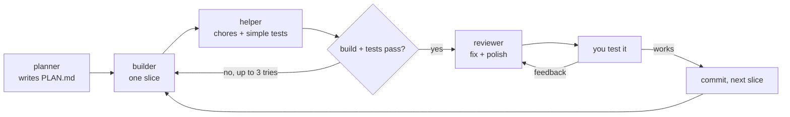

# Build Loop for Claude Code

A small team of AI agents that build software the careful way: **plan first, then build, test, review and polish one small slice at a time**, with you testing each slice before the next one starts.

It was used to build [Remindr](https://github.com/Randomstufteam/Remindr), a Windows reminders app with profiles, a calendar, 32 languages and an animated installer.

## What's inside

| Part | Type | Model | Job |
|---|---|---|---|
| **build-loop** | Skill | n/a | Runs the whole loop and hands each step to the right agent. Start it with `/build-loop` or by asking Claude to build a feature. |
| **planner** | Agent | Opus | Reads the code, asks questions if the request is vague, and writes `PLAN.md`: tech choices, small slices in order, each with a way to test it. Never edits code. |
| **builder** | Agent | Sonnet | Implements exactly one slice (including its UI), builds the project and lists what it changed and what is untested. |
| **reviewer** | Agent | Opus | Checks the builder's work for bugs and plan mismatches, fixes small issues itself, polishes the UI and lists what you should test by hand. |
| **helper** | Agent | Haiku | Cheap, fast chores: boilerplate, renaming, formatting, searching, comments and simple unit tests. Never makes design decisions. |

## How the loop works



1. **Plan once.** The planner writes `PLAN.md` and you approve it.
2. **For each slice:** build, chores, run the checks, review, then **you test it**, then polish and commit.
3. **Rules:** one slice at a time, no claiming something works unless it was run or you confirmed it, small focused tasks for each agent, and back to the planner if the plan turns out wrong.

## Install

In Claude Code, run:

```
/plugin marketplace add Randomstufteam/claude-build-loop
/plugin install build-loop@randomstufteam
```

Then ask Claude to build something ("add a settings page with a dark mode toggle") or type `/build-loop`.

### Manual install

Copy the files into your Claude Code folder instead:

- `agents/*.md` to `~/.claude/agents/`
- `skills/build-loop/` to `~/.claude/skills/build-loop/`

## Customize

The agents are tuned for **C# / Windows desktop** projects (that's what they were built for), but they are plain Markdown. To use them for another stack, edit the first line of each agent in `agents/` (for example "You are the builder for a TypeScript web app"). You can also change the `model:` line to use different models.

## License

MIT. See [LICENSE](LICENSE).
